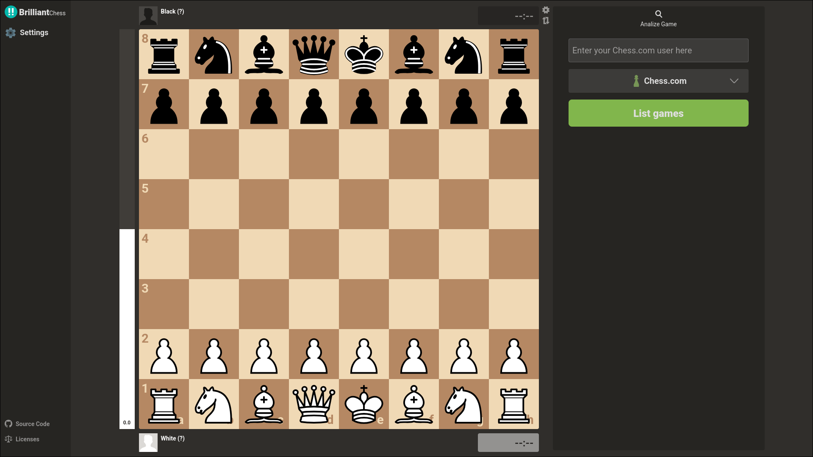

# Chessmate - Professional Chess Game Review

An advanced, open-source chess analysis platform and Game Review engine designed to replicate and match **Chess.com Game Review** (Classification V2, CAPS2 accuracy scoring, performance ratings, and brilliant move sacrifice detection) with **100% free, unlimited, native or browser-based analysis**.



---

## Key Features

1. **Chess.com Classification V2 Parity**:
   - **Expected Points Model**: Converts Stockfish centipawn evaluations to winning expectancy $E(cp, rating) = \frac{1}{1 + 10^{-cp / (400 \cdot s(rating))}}$.
   - **CAPS2 Move Accuracy**: Normalizes $\Delta E$ loss into an intuitive grading curve calibrated against real player rating bands.
   - **Harmonic Power-Mean Aggregation**: Prevents game-deciding blunders from being masked by simple opening book moves ($p = 0.25$ power-mean blend).
   - **Estimated Performance Rating**: Dynamic calculation based on game accuracy, move deviations, and established player Elo.

2. **Brilliant Move (!!) Algorithm (4 Strict Criteria)**:
   - **Sacrifice Identification**: Full Static Exchange Evaluation (SEE) detecting volunteer piece/exchange sacrifices (knights, bishops, rooks, queens).
   - **Objective Engine Soundness**: Must preserve parity or advantage ($\Delta E \le 0.025$, $E_{after} \ge 0.42$).
   - **Contested State Precondition**: Position prior to the sacrifice cannot already be winning (evaluation $\le +3.50$, $E_{before} \le 0.88$).
   - **Game Phase Constraint**: In endgames ($< 7$ pieces), the sacrifice must be the sole unique path to victory.

3. **High-Performance Dual-Engine Infrastructure**:
   - **Native Stockfish 19 Universal Binary**: Pre-bundled Windows x86_64 executable running multi-threaded analysis via a local WebSocket bridge in `server.js`.
   - **WebAssembly Fallback**: Multi-threaded SharedArrayBuffer Stockfish WebAssembly, with single-threaded and ASM.js fallbacks for browsers without SharedArrayBuffer support.

4. **Chrome Extension (Chess.com Review Extractor)**:
   - Manifest V3 Chrome extension in `extension/`.
   - One-click export of official Chess.com game reviews, move classifications, centipawns, and CAPS2 accuracies to JSON.

---

## Directory Layout

```
chessmate/
├── src/                          # Next.js 15 application source
│   ├── app/                      # App router routes (/)
│   ├── components/               # React UI components
│   │   ├── game/                 # Chessboard, clocks, evaluations, piece renderers
│   │   ├── menu/                 # Analysis panels, move lists, summary cards
│   │   │   ├── analysis/         # Move commentary, accuracy breakdown, game charts
│   │   │   └── analyze/          # Chess.com archive loaders and PGN/FEN form
│   │   └── nav/                  # Navigation bar, settings (themes, sound, rating)
│   ├── context/                  # React contexts (AnalyzeContext, ConfigContext, ErrorsContext)
│   └── engine/                   # Engine bridges, worker managers, and heuristics
│       ├── stockfish.ts          # Core Expected Points, CAPS2, classification & sacrifice rules
│       ├── engineWorker.ts       # Native WebSocket bridge + WebAssembly fallback manager
│       └── wasmChecks.ts         # Browser hardware concurrency and WASM capabilities
├── stockfish/                    # Native engine distribution
│   └── stockfish-windows-x86-64-universal.exe   # Stockfish 19 native Windows binary
├── scripts/                      # Test suites, parity benchmarks, and calibration scripts
│   ├── README.md                 # Documentation for all evaluation scripts
│   ├── test_classification_parity.js # Move classification accuracy vs Chess.com ground truth
│   ├── analyze_sample_accuracies.js  # Move-by-move Expected Points loss and accuracy test
│   ├── test_calibrated_weights.js    # Discrete category weight solver test
│   ├── test_review_benchmark.js      # End-to-end game review benchmark with native Stockfish
│   └── test_sf_speed.js              # Native engine throughput test
├── extension/                    # Manifest V3 Chrome Extension for Chess.com review extraction
├── review_data/                  # 67 real Chess.com game review extractions (ground truth dataset)
├── documents/                    # Reverse-engineering documentation & technical architecture
├── public/                       # Static assets (WASM engines, opening books, audio, images)
├── server.js                     # Production HTTP server + Native Stockfish WebSocket bridge
├── sample_extracted_review.json  # Reference game review ground truth (Game #184653017586)
├── batch_extract_reviews.js      # Puppeteer crawler for automated review extraction
└── chess_review_extractor.js     # Browser console script for on-demand review extraction
```

---

## Getting Started

### 1. Installation

```bash
npm install
```

### 2. Running the Application

#### Option A: Full Mode with Native Stockfish 19 (Recommended)
This launches the Node.js server with the high-performance native Stockfish 19 WebSocket bridge:

```bash
npm run build
npm run start
```
Open [http://localhost:3000](http://localhost:3000).

#### Option B: Next.js Development Server
```bash
npm run dev
```

### 3. Verification & Benchmarks

```bash
# Verify TypeScript types
npm run typecheck

# Test move classification parity vs Chess.com
npm run test:parity

# Test Expected Points and CAPS2 accuracy calculation
npm run test:accuracy

# Run end-to-end benchmark with native Stockfish 19
npm run benchmark

# Test Stockfish engine search speed
npm run test:speed
```

---

## Chrome Extension Setup

1. Open Chrome and navigate to `chrome://extensions/`.
2. Enable **Developer mode** in the top right.
3. Click **Load unpacked** and select the [`extension/`](extension/) directory.
4. Navigate to any Chess.com game review page to extract reviews into the calibration format.
